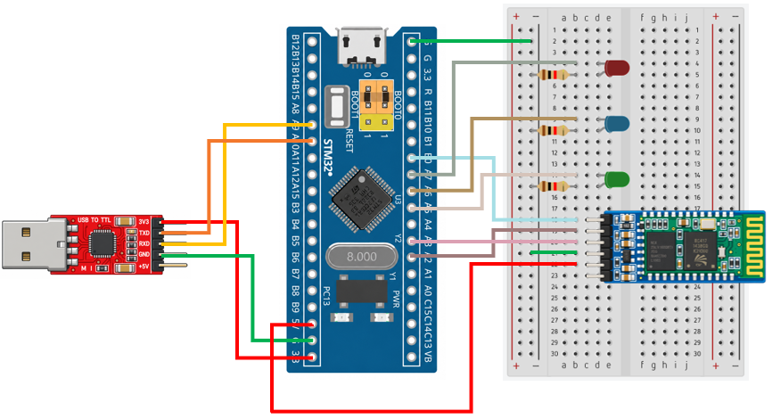

# STM32 Project - CC2541 BLE

這是一個基於 STM32F103C8T6 微控制器的示例專案，展示如何透過 CC2541 藍牙模組與手機建立無線通訊，實現 LED 遠端控制及狀態監測

## 硬體需求

* STM32F103C8T6 微控制器 x1
* CC2541 BLE 藍牙模組 ×1
* ST-Link 燒錄器 ×1
* LED ×3
* 220Ω 電阻 x3
* 手機 ×1 (支援 BLE)

## 軟體需求

* VSCode
* EIDE
* Keil MDK ARM Toolchain
* CMSIS Device Header
* BLE Scanner (手機 App)

## 電路圖

## 構建和編譯

1. 使用 VSCode 開啟專案資料夾
2. 確認 EIDE 已設定 Keil MDK-Arm Toolchain
3. 執行 Build
4. 產生 HEX 檔
5. 使用 ST-Link 將程式燒錄至 STM32F103C8T6
6. 開啟 BLE Scanner，掃描附近的 BLE 裝置
7. 選擇 BT05 並建立連線
8. 找到 CUSTOM SERVICE 的 CUSTOM CHARACTERISTIC
9. 啟用 Notify，並透過 Write (Text 格式) 傳送 LED 控制指令

## 使用方法

將程式燒錄至 STM32F103C8T6。手機透過 BLE Scanner 連線至 CC2541 後，可以傳送 LED 指令。STM32 接收到指令後，切換對應 LED 的開關狀態。
STM32 每隔 0.5 秒讀取三顆 LED 的目前狀態，並透過 UART 傳送至 CC2541，再由 CC2541 使用 BLE Notify 回傳至手機

LED 控制命令：
| 傳送命令  | 功能     |
| ----- | ------ |
| `led1`  | 切換 LED1 的狀態 |
| `led2` | 切換 LED2 的狀態 |
| `led3` | 切換 LED3 的狀態 |

## 功能介紹

* BLE 無線通訊

    CC2541 透過 BLE 與手機建立無線連線，接收手機傳送的 LED 控制指令，並回傳 LED 狀態

* UART 資料傳輸

    STM32 透過 USART 與 CC2541 進行雙向資料交換，接收手機指令並傳送 LED 狀態資訊

* LED Toggle 控制

    STM32 接收到 LED 指令後，透過 GPIO 切換對應 LED 的輸出狀態

* 手機即時監測

    使用者可透過 BLE Scanner 的 Notify 功能接收 LED 狀態資訊，無須額外架設 Web Server 或連接 Wi-Fi