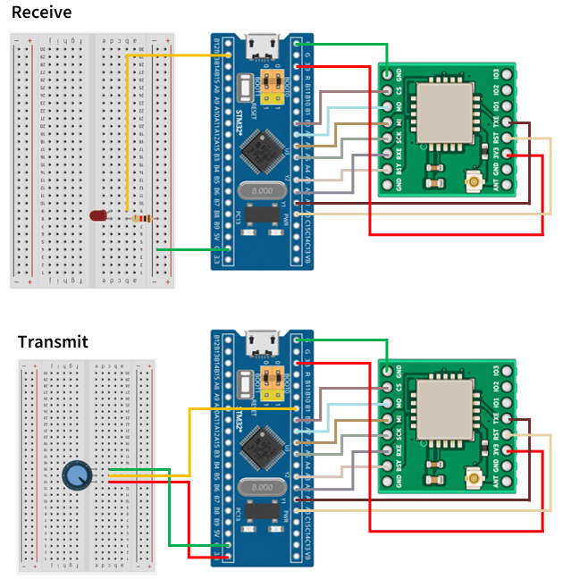

# STM32 Project - SX1262

這是一個基於 STM32F103C8T6 微控制器的示例專案，展示如何透過兩組 STM32 建立 LoRa 通訊，實現電位器遠端調整 LED 亮度的功能

## 硬體需求

* STM32F103C8T6 微控制器 ×2
* E22-900M22S 模組 ×2
* ST-Link 燒錄器 ×1
* LED ×1
* 220Ω 電阻 x1
* 電位器 ×1

## 軟體需求

* VSCode
* EIDE
* Keil MDK ARM Toolchain
* CMSIS Device Header

## 電路圖

## 構建和編譯

1. 使用 VSCode 開啟專案資料夾
2. 確認 EIDE 已設定 Keil MDK-Arm Toolchain
3. 執行 Build
4. 產生 HEX 檔
5. 使用 ST-Link 分別將不同的 main 程式燒錄至兩個 STM32F103C8T6
6. 旋轉發送端電位器，觀察接收端 LED 亮度變化

## 使用方法

將發送端與接收端程式分別燒錄至兩個 STM32F103C8T6。

發送端 STM32 透過 ADC 讀取電位器的電壓值，並將 ADC 數值轉換為 0～100% 的亮度百分比，再透過 LoRa 模組無線傳送。

接收端 STM32 透過 SX1262 接收亮度資料，將接收到的百分比轉換為 PWM Duty Cycle，控制 LED 的亮度。

當電位器旋轉時，LED 亮度會隨之改變。

## 功能介紹

* LoRa 無線通訊

    兩個 STM32 分別透過 SPI 控制 SX1262 模組，建立點對點無線通訊，實現遠端 LED 亮度控制

* SPI 資料傳輸

    STM32 透過 SPI 介面與 SX1262 進行資料交換，完成 LoRa 封包發送與接收

* ADC 類比訊號讀取

    發送端 STM32 使用內建 ADC 讀取電位器的電壓變化，並將 ADC 數值轉換為 0 ～ 100% 的亮度百分比

* PWM LED 亮度控制

    接收端 STM32 產生 PWM 訊號，根據接收到的亮度百分比調整 Duty Cycle，控制 LED 的亮度