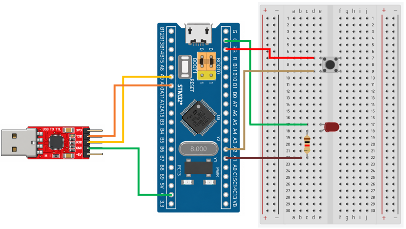

# STM32 Project - Power Control

這是一個基於 STM32F103C8T6 微控制器的低功耗控制示例專案，展示如何使用 STM32 的電源管理功能，讓微控制器進入不同的低功耗模式，並透過中斷或喚醒腳位恢復運作

## 硬體需求

* STM32F103C8T6 微控制器 x1
* LED ×1
* 按鈕 ×1
* 220Ω 電阻 ×1
* ST-Link 燒錄器
* USB-TTL 模組 (專案使用 CP2102 模組)

## 軟體需求

* VSCode
* EIDE
* Keil MDK ARM Toolchain
* CMSIS Device Header
* 序列埠監控軟體（例如：串口調試助手）

## 電路圖

## 構建和編譯

1. 使用 VSCode 開啟專案資料夾
2. 確認 EIDE 已設定 Keil MDK-Arm Toolchain
3. 執行 Build
4. 產生 HEX 檔
5. 使用 ST-Link 將程式燒錄至 STM32F103C8T6

## 使用方法

將程式燒錄至 STM32F103C8T6，開啟序列埠監控軟體，觀察微控制器進入低功耗模式及喚醒後的執行情況。

測試的喚醒方式包括：

* 周邊裝置中斷：透過 UART 周邊裝置產生中斷

* 外部中斷 (EXTI)：透過 GPIO 腳位觸發外部中斷

* WKUP 腳位：透過 PA0 腳位的上升緣訊號，將微控制器喚醒並重新啟動

## 功能介紹

* 睡眠模式

    進入睡眠模式後，CPU 將停止執行，但周邊時鐘仍可持續運作，SRAM 和暫存器內容也會保留。當中斷事件發生時，可喚醒 CPU，並從原本停止的位置繼續執行程式

* 停止模式

    進入停止模式後，CPU 將停止執行，HSI 和 HSE 振盪器關閉，但 SRAM 和暫存器內容仍會保留。當 EXTI 中斷觸發時，可喚醒 CPU，並從原本停止的位置繼續執行程式，但喚醒後需要重新設定系統時鐘

* 待機模式

    進入待機模式後，CPU 將停止執行，SRAM 和大部分暫存器內容會遺失，且功耗為三種低功耗模式中最低。當 WKUP 腳位偵測到上升緣訊號時，可喚醒微控制器並使系統重新啟動