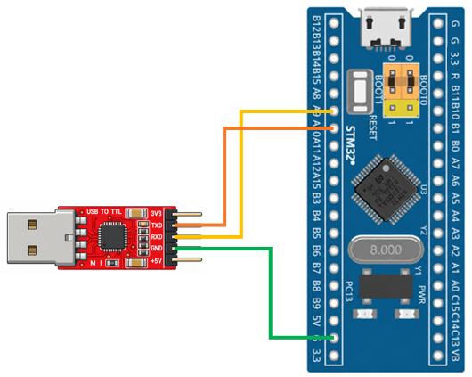

# STM32 Project - Backup Data

這是一個基於 STM32F103C8T6 微控制器示例專案，展示如何使用 STM32 的備份功能進行資料儲存與讀取，並透過備份暫存器的特性，在系統重置後保留資料

## 硬體需求

* STM32F103C8T6 微控制器 x1
* ST-Link 燒錄器
* USB-TTL 模組 (專案使用 CP2102 模組)

## 軟體需求

* VSCode
* EIDE
* Keil MDK ARM Toolchain
* CMSIS Device Header
* 序列埠監控軟體（例如：串口調試助手）

## 電路圖

## 構建和編譯

1. 使用 VSCode 開啟專案資料夾
2. 確認 EIDE 已設定 Keil MDK-Arm Toolchain
3. 執行 Build
4. 產生 HEX 檔
5. 使用 ST-Link 將程式燒錄至 STM32F103C8T6

## 使用方法

將程式燒錄至 STM32F103C8T6，開啟序列埠監控軟體，透過程式讀寫備份暫存器，觀察資料儲存與讀取結果，並測試系統重置後的資料保持情況

## 功能介紹

* 備份資料暫存器

    用於儲存使用者資料。當系統重置後，資料仍可保留
