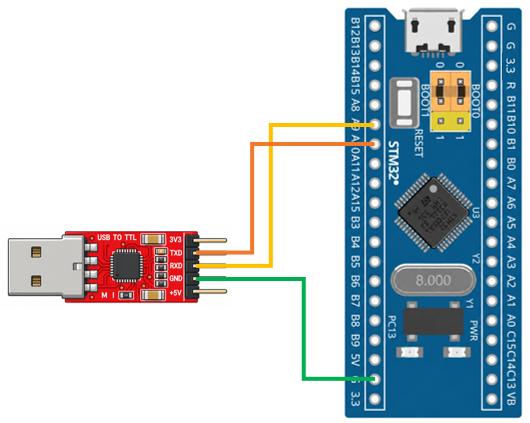

# STM32 Project - Real Time Clock

這是一個基於 STM32F103C8T6 微控制器示例專案，展示如何使用 RTC 搭配待機模式，實現低功耗定時喚醒功能

## 硬體需求

- STM32F103C8T6 微控制器 x1
- ST-Link 燒錄器
- USB-TTL 模組 (專案使用 CP2102 模組)

## 軟體需求

- VSCode
- EIDE
- Keil MDK ARM Toolchain
- CMSIS Device Header
- 序列埠監控軟體（例如：串口調試助手）

## 電路圖

## 構建和編譯

1. 使用 VSCode 開啟專案資料夾
2. 確認 EIDE 已設定 Keil MDK-Arm Toolchain
3. 執行 Build
4. 產生 HEX 檔
5. 使用 ST-Link 將程式燒錄至 STM32F103C8T6

## 使用方法

將程式燒錄至 STM32F103C8T6，開啟序列埠監控軟體，觀察 RTC 定時喚醒的執行結果。
透過設定 RTC Alarm 喚醒時間，每隔 5 秒從待機模式喚醒，並透過 USART 輸出目前時間，隨後再次進入待機模式，以達到週期性喚醒與低功耗運作的目的

## 功能介紹

- **RTC 實時時鐘**

  使用 LSE 作為 RTC 時鐘來源，透過預除頻器產生約 1 Hz 的計數頻率，實現以秒為單位的時間計數

- **RTC Alarm 定時喚醒**

  設定 RTC Alarm，每隔約 5 秒產生一次鬧鐘事件，喚醒處於待機模式的微控制器

- **待機模式**

  進入待機模式後，CPU 將停止執行，SRAM 和大部分暫存器內容會遺失，是最低功耗的模式
