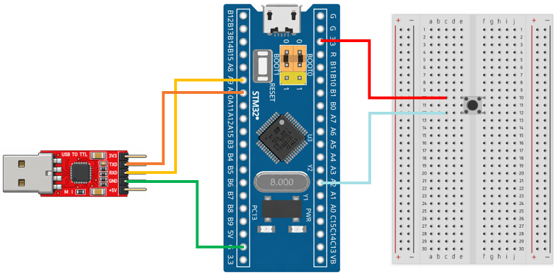

# STM32 Project - Watchdog

這是一個基於 STM32F103C8T6 微控制器示例專案，展示如何使用獨立看門狗監控程式狀態，並在未能於指定時間內餵狗時，自動重置微控制器，以提高系統的可靠性與穩定性

## 硬體需求

- STM32F103C8T6 微控制器 x1
- ST-Link 燒錄器
- USB-TTL 模組 (專案使用 CP2102 模組)
- 按鈕 x1

## 軟體需求

- VSCode
- EIDE
- Keil MDK ARM Toolchain
- CMSIS Device Header
- 序列埠監控軟體（例如：串口調試助手）

## 電路圖

## 構建和編譯

1. 使用 VSCode 開啟專案資料夾
2. 確認 EIDE 已設定 Keil MDK-Arm Toolchain
3. 執行 Build
4. 產生 HEX 檔
5. 使用 ST-Link 將程式燒錄至 STM32F103C8T6

## 使用方法

將程式燒錄至 STM32F103C8T6，開啟序列埠監控軟體，觀察獨立看門狗的運作情況。
程式啟動後，會持續輸出 `working...`，模擬系統正常執行。每次完成工作後，重新載入看門狗計數器，避免系統重置。當使用者按下按鈕時，程式將額外延遲 3 秒，模擬異常情況，看門狗便會觸發系統重置。透過觀察序列埠重新輸出 `Good Morning!!!`，可以確認微控制器已重新啟動

## 功能介紹

- **IWDG 獨立看門狗**

  使用 LSI 作為時鐘來源，IWDG 不依賴主系統時鐘，即使主時鐘發生異常，仍可持續運作

- **餵狗**

  程式正常執行時，定期重新載入 IWDG 計數器，避免計數器遞減至零而觸發系統重置
